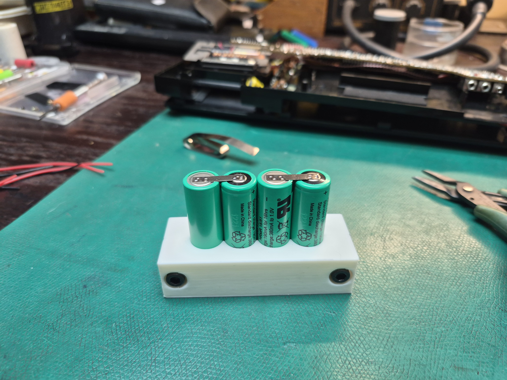

A set of fixtures for holding various size batteries for welding up packs. The models are included, they were done in Fusion 360 and are parametric. You can change the number of cells and cell diameter to customize fixtures. They are designed to use 10-32 screws and nuts of appropriate length to clamp fixture halves. This can be changed 5mm, etc. in the Fusion model if you wish.

